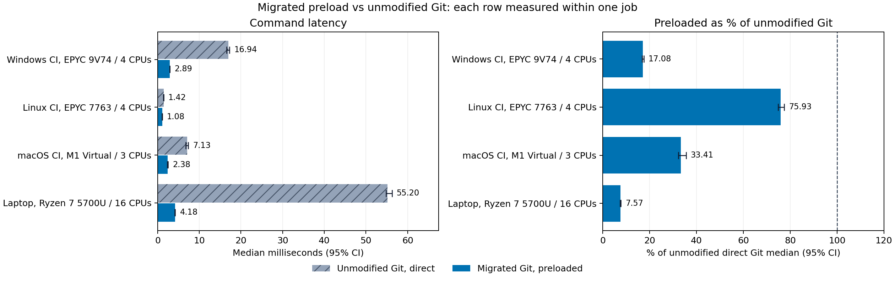

# Migrated preload vs unmodified Git

Each row is measured within one job on one machine. Unmodified Git is the
upstream revision this work branches from, built with identical flags and
launched directly. Each direct call is interleaved with a preloaded call.
Superscript and subscript values are the distances to the upper and lower
bounds of the 95% bootstrap confidence interval of the median.

| Machine | Unmodified Git ms (95% CI) | Migrated preloaded ms (95% CI) | % of unmodified (95% CI) | Change % |
| --- | ---: | ---: | ---: | ---: |
| Windows CI, EPYC 9V74 / 4 CPUs | 16.94+0.29-0.41 | 2.893+0.014-0.018 | 17.08%+0.44-0.30 | -82.92% |
| Linux CI, EPYC 7763 / 4 CPUs | 1.421+0.017-0.028 | 1.0790+0.0050-0.0070 | 75.9%+1.6-1.0 | -24.1% |
| macOS CI, M1 Virtual / 3 CPUs | 7.13+0.21-0.37 | 2.381+0.093-0.064 | 33.4%+2.1-1.2 | -66.6% |
| Laptop, Ryzen 7 5700U / 16 CPUs | 55.20+1.03-0.36 | 4.181+0.049-0.053 | 7.575%+0.097-0.175 | -92.425% |

Machine metadata, compiler flags, revisions, binary digests and raw samples
are in [graph-evidence.json](graph-evidence.json). No timings are pooled
across machines.
