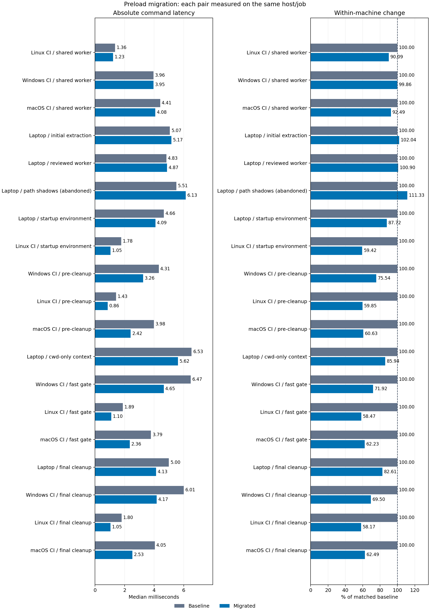

# Matched preload performance

Each row compares revisions on one host/job. Lower latency is better.

| Machine / stage | Baseline ms | Migrated ms | Change ms | Baseline % | Change % |
| --- | ---: | ---: | ---: | ---: | ---: |
| Linux CI / shared worker | 1.3620 | 1.2270 | -0.1350 | 90.09% | -9.91% |
| Windows CI / shared worker | 3.9595 | 3.9540 | -0.0055 | 99.86% | -0.14% |
| macOS CI / shared worker | 4.4125 | 4.0810 | -0.3315 | 92.49% | -7.51% |
| Laptop / initial extraction | 5.0670 | 5.1705 | +0.1035 | 102.04% | +2.04% |
| Laptop / reviewed worker | 4.8295 | 4.8730 | +0.0435 | 100.90% | +0.90% |
| Laptop / path shadows (abandoned) | 5.5095 | 6.1340 | +0.6245 | 111.33% | +11.33% |
| Laptop / startup environment | 4.6580 | 4.0860 | -0.5720 | 87.72% | -12.28% |
| Linux CI / startup environment | 1.7755 | 1.0550 | -0.7205 | 59.42% | -40.58% |
| Windows CI / pre-cleanup | 4.3145 | 3.2590 | -1.0555 | 75.54% | -24.46% |
| Linux CI / pre-cleanup | 1.4295 | 0.8555 | -0.5740 | 59.85% | -40.15% |
| macOS CI / pre-cleanup | 3.9835 | 2.4150 | -1.5685 | 60.63% | -39.37% |
| Laptop / cwd-only context | 6.5345 | 5.6155 | -0.9190 | 85.94% | -14.06% |
| Windows CI / fast gate | 6.4705 | 4.6535 | -1.8170 | 71.92% | -28.08% |
| Linux CI / fast gate | 1.8900 | 1.1050 | -0.7850 | 58.47% | -41.53% |
| macOS CI / fast gate | 3.7870 | 2.3565 | -1.4305 | 62.23% | -37.77% |
| Laptop / final cleanup | 5.0000 | 4.1305 | -0.8695 | 82.61% | -17.39% |
| Windows CI / final cleanup | 6.0075 | 4.1750 | -1.8325 | 69.50% | -30.50% |
| Linux CI / final cleanup | 1.8050 | 1.0500 | -0.7550 | 58.17% | -41.83% |
| macOS CI / final cleanup | 4.0470 | 2.5290 | -1.5180 | 62.49% | -37.51% |

Full machine metadata, compiler flags, source digests and raw samples are in
[graph-evidence.json](graph-evidence.json). Missing historical hardware fields
remain unspecified. No timings are averaged across machines.

Laptop / startup environment: git --version; environment unchanged after manager startup. Baseline: complete environment snapshot per command; candidate: environment inherited from manager startup. This row measures the stated contract as well as implementation changes.

Linux CI / startup environment: git --version; environment unchanged after manager startup. Baseline: complete environment snapshot per command; candidate: environment inherited from manager startup. This row measures the stated contract as well as implementation changes.

Windows CI / pre-cleanup: git --version; environment unchanged after manager startup. Baseline: complete environment snapshot per command; candidate: environment inherited from manager startup. This row measures the stated contract as well as implementation changes.

Linux CI / pre-cleanup: git --version; environment unchanged after manager startup. Baseline: complete environment snapshot per command; candidate: environment inherited from manager startup. This row measures the stated contract as well as implementation changes.

macOS CI / pre-cleanup: git --version; environment unchanged after manager startup. Baseline: complete environment snapshot per command; candidate: environment inherited from manager startup. This row measures the stated contract as well as implementation changes.

Laptop / cwd-only context: git --version; environment unchanged after manager startup. Baseline: complete environment snapshot per command; candidate: environment inherited from manager startup. This row measures the stated contract as well as implementation changes.

Windows CI / fast gate: git --version; environment unchanged after manager startup. Baseline: complete environment snapshot per command; candidate: environment inherited from manager startup. This row measures the stated contract as well as implementation changes.

Linux CI / fast gate: git --version; environment unchanged after manager startup. Baseline: complete environment snapshot per command; candidate: environment inherited from manager startup. This row measures the stated contract as well as implementation changes.

macOS CI / fast gate: git --version; environment unchanged after manager startup. Baseline: complete environment snapshot per command; candidate: environment inherited from manager startup. This row measures the stated contract as well as implementation changes.

Laptop / final cleanup: git --version; environment unchanged after manager startup. Baseline: complete environment snapshot per command; candidate: environment inherited from manager startup. This row measures the stated contract as well as implementation changes.

Windows CI / final cleanup: git --version; environment unchanged after manager startup. Baseline: complete environment snapshot per command; candidate: environment inherited from manager startup. This row measures the stated contract as well as implementation changes.

Linux CI / final cleanup: git --version; environment unchanged after manager startup. Baseline: complete environment snapshot per command; candidate: environment inherited from manager startup. This row measures the stated contract as well as implementation changes.

macOS CI / final cleanup: git --version; environment unchanged after manager startup. Baseline: complete environment snapshot per command; candidate: environment inherited from manager startup. This row measures the stated contract as well as implementation changes.
