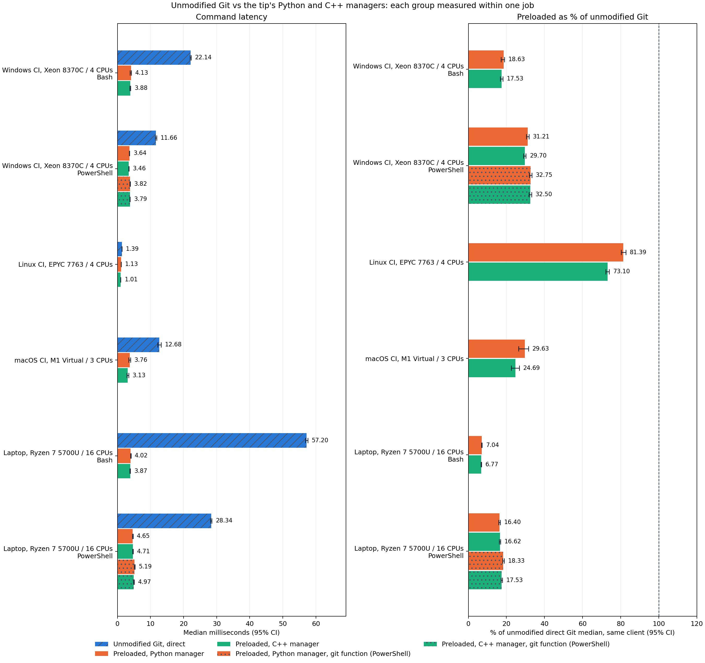

# Unmodified Git vs the tip's Python and C++ managers

Each group is measured within one job on one machine. Unmodified Git is the
upstream revision this work branches from, built with identical flags and
launched directly. Both preloaded variants are the same tip build (worker and
clients), with the C++ manager or the Python manager. PowerShell groups also
time the generated git function. Percentages use the same client's
unmodified reference. Superscript and subscript values are the distances to
the bounds of the 95% bootstrap confidence interval of the median.

| Group | Unmodified ms | Python ms | C++ ms | Python fn ms | C++ fn ms | Python % | C++ % | Python fn % | C++ fn % |
| --- | ---: | ---: | ---: | ---: | ---: | ---: | ---: | ---: | ---: |
| Windows CI, Xeon 8370C / 4 CPUs, Bash | 22.14+0.15-0.17 | 4.126+0.084-0.332 | 3.88+0.14-0.16 | — | — | 18.63%+0.41-1.48 | 17.53%+0.66-0.72 | — | — |
| Windows CI, Xeon 8370C / 4 CPUs, PowerShell | 11.66+0.23-0.17 | 3.641+0.065-0.036 | 3.465+0.044-0.069 | 3.821+0.051-0.047 | 3.791+0.073-0.042 | 31.21%+0.64-0.67 | 29.70%+0.57-0.75 | 32.75%+0.63-0.75 | 32.50%+0.68-0.67 |
| Linux CI, EPYC 7763 / 4 CPUs | 1.3865+0.0135-0.0095 | 1.128+0.017-0.010 | 1.0135+0.0115-0.0075 | — | — | 81.4%+1.3-1.1 | 73.10%+0.89-0.86 | — | — |
| macOS CI, M1 Virtual / 3 CPUs | 12.68+0.54-0.45 | 3.76+0.19-0.36 | 3.13+0.28-0.24 | — | — | 29.6%+2.0-3.3 | 24.7%+2.1-2.1 | — | — |
| Laptop, Ryzen 7 5700U / 16 CPUs, Bash | 57.20+0.36-0.33 | 4.024+0.085-0.060 | 3.870+0.063-0.084 | — | — | 7.04%+0.16-0.12 | 6.77%+0.12-0.17 | — | — |
| Laptop, Ryzen 7 5700U / 16 CPUs, PowerShell | 28.34+0.22-0.22 | 4.65+0.11-0.10 | 4.710+0.070-0.089 | 5.19+0.13-0.10 | 4.969+0.112-0.098 | 16.40%+0.41-0.39 | 16.62%+0.28-0.33 | 18.33%+0.48-0.37 | 17.53%+0.40-0.35 |

Machine metadata, compiler flags, revisions, binary digests and raw samples
are in [graph-evidence.json](graph-evidence.json). No timings are pooled
across machines.
